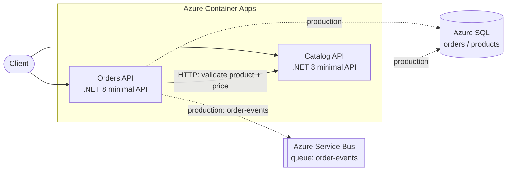

# Azure E-Commerce Microservices

**Built by Pratik Sheth**

A sample e-commerce backend split into two .NET 8 microservices — a
**Catalog API** and an **Orders API** — that run locally with Docker Compose
and deploy to **Azure Container Apps** with Bicep-provided **Azure SQL** and
**Azure Service Bus**.

## Architecture



- **Catalog API** (`services/CatalogApi`) — owns the product catalog: names,
  SKUs, prices, stock. It is the system of record for product data.
- **Orders API** (`services/OrdersApi`) — owns orders. Before accepting an
  order it calls the Catalog API over HTTP to confirm the product exists and
  to snapshot its current price, so later price changes never rewrite order
  history. If the catalog is unreachable, order placement fails with 502
  rather than accepting an unvalidated order.
- Locally both services use in-memory stores so the sample runs anywhere. In
  the Azure deployment (below), connection strings for Azure SQL and Service
  Bus are injected as container-app secrets/configuration, ready for the
  services to adopt durable storage and publish `order-events` messages.

## Run locally with Docker Compose

Prerequisites: Docker with Compose.

```bash
docker compose up --build
```

- Catalog API → http://localhost:5001
- Orders API → http://localhost:5002

Try it:

```bash
# List products
curl http://localhost:5001/api/products

# Place an order (validated against the Catalog API)
curl -X POST http://localhost:5002/api/orders \
  -H "Content-Type: application/json" \
  -d '{"customerEmail": "customer@example.com", "productId": 2, "quantity": 3}'

# List orders
curl http://localhost:5002/api/orders
```

## Run locally without Docker

Prerequisites: [.NET 8 SDK](https://dotnet.microsoft.com/download/dotnet/8.0)

```bash
# Terminal 1 — Catalog API on port 5001
dotnet run --project services/CatalogApi --urls http://localhost:5001

# Terminal 2 — Orders API on port 5002 (its appsettings.json already
# points CatalogApi:BaseUrl at http://localhost:5001)
dotnet run --project services/OrdersApi --urls http://localhost:5002
```

## Endpoints

| Service     | Method | Route                | Description                          |
| ----------- | ------ | -------------------- | ------------------------------------ |
| Catalog API | GET    | `/health`            | Health check                         |
| Catalog API | GET    | `/api/products`      | List products                        |
| Catalog API | GET    | `/api/products/{id}` | Get a product                        |
| Catalog API | POST   | `/api/products`      | Create a product                     |
| Orders API  | GET    | `/health`            | Health check                         |
| Orders API  | GET    | `/api/orders`        | List orders                          |
| Orders API  | GET    | `/api/orders/{id}`   | Get an order                         |
| Orders API  | POST   | `/api/orders`        | Place an order (validates via Catalog API) |

## Azure deployment outline

Infrastructure is defined in [`infra/main.bicep`](infra/main.bicep):

- **Azure Container Apps** environment (with Log Analytics) hosting both APIs
- **Azure SQL Database** (serverless) as the durable store, connection string
  delivered to both apps as a Container Apps secret
- **Azure Service Bus** (Standard) with an `order-events` queue and a
  least-privilege Send/Listen authorization rule for the Orders API
- The Orders app receives `CatalogApi__BaseUrl` pointing at the Catalog app's
  FQDN — the same configuration key used locally and in Compose

Deploy:

```bash
# 1. Build and push the images to your container registry
docker build -t myregistry.azurecr.io/catalog-api:latest services/CatalogApi
docker build -t myregistry.azurecr.io/orders-api:latest  services/OrdersApi
docker push myregistry.azurecr.io/catalog-api:latest
docker push myregistry.azurecr.io/orders-api:latest

# 2. Deploy the infrastructure (supply the SQL password at deploy time)
az group create --name rg-ecommerce-dev --location westus2
az deployment group create \
  --resource-group rg-ecommerce-dev \
  --template-file infra/main.bicep \
  --parameters infra/main.bicepparam \
  --parameters sqlAdminPassword='<strong-password>'
```

The deployment outputs the public URLs of both APIs, the SQL server FQDN,
and the Service Bus namespace/queue names.

## Project structure

```
services/
  CatalogApi/   Product catalog minimal API (+ Dockerfile)
  OrdersApi/    Orders minimal API, calls Catalog API (+ Dockerfile)
infra/
  main.bicep        Container Apps + Azure SQL + Service Bus
  main.bicepparam   Sample parameters
docker-compose.yml  Local two-service stack
```

## Author

**Pratik Sheth** — Principal Software Engineer
LinkedIn: https://www.linkedin.com/in/pratik-s-a85a3317
Location: Buena Park, CA

## License

MIT — see [LICENSE](LICENSE).
